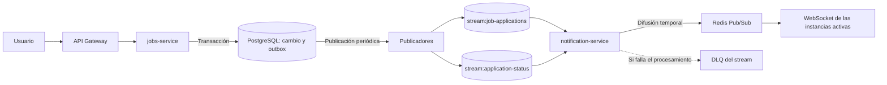

# Guía de evaluación EP5: streams de Catch & Go

Esta guía describe el código actual y sirve para preparar una demostración. El proyecto usa Redis Streams. Según lo informado por el equipo, Redis fue aceptado para esta evaluación; el encargo escrito menciona Kafka, RabbitMQ y Angular. Conviene presentar la autorización correspondiente y confirmar cómo se evaluarán esas diferencias. Esta guía no acredita por sí sola que las pruebas se hayan ejecutado ni garantiza una nota.

## Arquitectura y propósito

Catch & Go conecta empresas y trabajadores. Se implementaron dos eventos para informar cambios en una postulación sin obligar a `jobs-service` a esperar el procesamiento de la notificación:

| Flujo | Qué ocurre | Stream | Grupo | Destinatario |
|---|---|---|---|---|
| Nueva postulación | Un trabajador postula a una oferta. | `stream:job-applications` | `notifications-group` | Empresa de la oferta |
| Cambio de estado | Se modifica el estado de la postulación. | `stream:application-status` | `application-status-notifications` | Trabajador que postuló |



`JobOfferService` guarda el cambio y el evento en una misma transacción de PostgreSQL. Un proceso del outbox publica después el evento en Redis. El consumidor lee el DTO, lo valida y difunde la notificación. Tras registrar su procesamiento, confirma el mensaje con ACK. Si el procesamiento falla, el mensaje puede quedar pendiente y recuperarse; hay una DLQ para registrar mensajes fallidos.

Como comparación, el endpoint `GET /matching/verify/{userId}` hace una consulta HTTP síncrona desde `matching-service` a `profile-service`. Es un endpoint de verificación; no se debe afirmar que la creación de ofertas active esos dos streams ni que `matching-service` sea su consumidor.

## Relación con la pauta

| Aspecto evaluado | Dónde revisarlo en el proyecto | Qué demostrar |
|---|---|---|
| Conexión y configuración | `application.yml` de `jobs-service` y `notification-service` | Ambos servicios usan el mismo Redis; mostrar los nombres de streams y grupos. |
| Dos flujos con DTO | `JobApplicationEvent`, `ApplicationStatusEvent` y sus publicadores y consumidores | Crear una postulación y luego cambiar su estado. |
| Publicación | `JobOfferService`, `OutboxService`, `OutboxRelay` y los dos publicadores | Ver el evento en el outbox y en el stream correspondiente. |
| Consumo y grupos | `StreamConsumerConfig` y los consumidores de `notification-service` | Inspeccionar los grupos, sus consumidores y mensajes pendientes. |
| Errores y recuperación | `PendingRecovery` y los métodos de gestión de DLQ | Ejecutar pruebas de fallos y explicar cuándo se confirma un mensaje. |
| Administración y retención | `QueueAdminController`, `QueueAdminService` y `StreamRetentionService` | Consultar streams, grupos, retención y DLQ con una cuenta ADMIN. |

Los archivos de código están dentro de `Producto/backend/services` o `Producto/backend/common/common-events`. Las pruebas de integración existen, pero deben ejecutarse con Docker disponible. Redis Streams tiene grupos y retención, pero no tiene equivalentes directos a todas las funciones de particiones, réplicas y configuraciones de Kafka mencionadas en la pauta.

## Preparar una demostración local

1. Trabajar en una base de datos de prueba. Los pasos siguientes crean una postulación y modifican su estado.
2. Configurar `.env` desde `.env.example`, incluyendo un `JWT_SECRET` privado compartido. Para probar Google también se necesitan las variables de Supabase indicadas en el README.
3. Iniciar Docker Desktop y, desde la raíz del proyecto, ejecutar `docker compose up -d --build`. Verificar el estado con `docker compose ps` y los logs si algún servicio no inicia.
4. Iniciar el frontend según el README. Tener una oferta de prueba, una cuenta de trabajador, una cuenta de empresa y una cuenta ADMIN ya autorizada. El registro público no permite crear un ADMIN.
5. Usar el JWT interno de cada cuenta para las peticiones protegidas. En el flujo de Google se obtiene después del intercambio con `auth-service`; el token de Supabase no se usa directamente para las rutas protegidas del gateway. No compartir ni registrar los tokens en capturas.

La prueba se puede hacer desde la interfaz o con las peticiones siguientes. Los valores entre `< >` son datos de prueba que deben reemplazarse, no deben escribirse literalmente. La empresa debe permanecer conectada para observar la primera notificación y el trabajador para observar la segunda.

Si prefieres Postman, importa [la colección de EP5](Postman_Collection_CatchAndGo_Mensajeria.json). Configura en un entorno local `baseUrl`, los tres tokens internos, `workerId`, `jobId` y, después de consultar las postulaciones, `applicationId`. Mantén los tokens fuera de archivos compartidos. Las peticiones de administración usan `adminToken`; las de escritura de negocio modifican datos y deben apuntar a un entorno de prueba. La colección no abre una conexión WebSocket ni reemplaza la observación de las notificaciones en la aplicación.

### 1. Crear una postulación

Con el token y el identificador del trabajador, y el ID de una oferta existente:

```powershell
$baseUrl = 'http://localhost:8080'
$workerToken = '<JWT_INTERNO_TRABAJADOR>'
$workerId = '<ID_TRABAJADOR>'
$jobId = '<ID_OFERTA>'
curl.exe -i -X POST "$baseUrl/jobs/$jobId/apply?userId=$workerId" -H "Authorization: Bearer $workerToken"
```

El endpoint no devuelve el ID de la postulación en el cuerpo. Se puede consultar con:

```powershell
curl.exe -i "$baseUrl/jobs/applications/user/$workerId" -H "Authorization: Bearer $workerToken"
```

Anotar el ID de la postulación creada. Verificar que la empresa recibe la alerta y revisar el stream `stream:job-applications`. Una respuesta HTTP exitosa indica que la postulación se guardó; la notificación se procesa después.

### 2. Cambiar el estado

Con el ID anterior y el token de la empresa de prueba:

```powershell
$companyToken = '<JWT_INTERNO_EMPRESA>'
$applicationId = '<ID_POSTULACION>'
Invoke-WebRequest -Method Put -Uri "$baseUrl/jobs/applications/$applicationId/status" -Headers @{ Authorization = "Bearer $companyToken" } -ContentType 'application/json' -Body (@{ status = 'ACEPTADO' } | ConvertTo-Json) -UseBasicParsing
```

Verificar la alerta del trabajador y revisar `stream:application-status`. El cuerpo de ambos endpoints de escritura puede estar vacío; comprobar el código HTTP y consultar los datos para validar el cambio.

### 3. Consultar streams y grupos

Con el token de una cuenta ADMIN existente:

```powershell
$adminToken = '<JWT_INTERNO_ADMIN>'
curl.exe -i "$baseUrl/queues" -H "Authorization: Bearer $adminToken"
curl.exe -i "$baseUrl/queues/job-applications/groups" -H "Authorization: Bearer $adminToken"
curl.exe -i "$baseUrl/queues/application-status/groups" -H "Authorization: Bearer $adminToken"
curl.exe -i "$baseUrl/queues/job-applications/retention" -H "Authorization: Bearer $adminToken"
curl.exe -i "$baseUrl/queues/application-status/retention" -H "Authorization: Bearer $adminToken"
curl.exe -i "$baseUrl/queues/job-applications/dlq" -H "Authorization: Bearer $adminToken"
curl.exe -i "$baseUrl/queues/application-status/dlq" -H "Authorization: Bearer $adminToken"
```

También se pueden inspeccionar los datos desde Redis Insight, disponible localmente en `http://localhost:5540`, o desde Redis CLI:

```powershell
docker compose exec redis redis-cli XINFO GROUPS stream:job-applications
docker compose exec redis redis-cli XINFO GROUPS stream:application-status
docker compose exec redis redis-cli XPENDING stream:job-applications notifications-group
docker compose exec redis redis-cli XPENDING stream:application-status application-status-notifications
```

El listado de pendientes puede estar vacío si el procesamiento ya terminó. Los streams y las DLQ pueden incluir entradas de inicialización con el campo `system`; no son eventos de negocio. Evitar purgar o eliminar streams que contengan datos necesarios.

Para administrar grupos de prueba, `POST /queues/{stream}/groups` crea un grupo y `DELETE /queues/{stream}/groups/{grupo}` intenta eliminarlo; ambos requieren ADMIN. La eliminación devuelve `409` si el grupo tiene mensajes pendientes, mensajes sin leer o consumidores registrados, o si es uno de los grupos principales. Los consumidores registrados incluyen consumidores antiguos: antes de retirarlos se deben revisar sus pendientes. No elimines los grupos de producción para realizar la demostración.

`POST /queues/{stream}/groups/{grupo}/replay` reinicia la posición de un grupo no protegido para volver a leer desde las entradas que aún se conservan en el stream. Solo ADMIN puede usarlo; devuelve `409` si el grupo tiene pendientes, consumidores registrados o es un grupo principal protegido. La operación puede volver a procesar eventos y no recupera entradas que ya fueron eliminadas por la retención. Úsala únicamente en datos de prueba y con un consumidor preparado para ese efecto.

### 4. Ejecutar la prueba de integración

Con Docker iniciado y Java 21, desde `Producto/backend`:

```powershell
mvn -pl services/notification-service -am "-Dtest=StreamFlowRedisIntegrationTest" "-Dsurefire.failIfNoSpecifiedTests=false" test
```

La prueba crea un Redis temporal y comprueba los dos eventos hasta el componente WebSocket y el ACK. No prueba la base de datos ni un navegador real. Si Docker no está disponible, puede aparecer como omitida aunque Maven muestre `BUILD SUCCESS`; revisar `Tests run` y `Skipped`. Las pruebas de PostgreSQL y outbox tienen su propia clase `OutboxRedisPostgresIntegrationTest`.

## Límites que se deben explicar

- Redis local usa AOF con sincronización cada segundo y una sola instancia: no ofrece replicación ni alta disponibilidad en esta configuración.
- La retención por longitud se intenta al publicar, pero conserva las entradas necesarias para los grupos existentes y sus mensajes pendientes. El límite puede superarse mientras haya trabajo sin procesar o no existan grupos. Las operaciones administrativas de purga o eliminación siguen borrando datos; deben usarse con cuidado.
- Redis Pub/Sub y WebSocket no confirman que una persona haya visto la notificación ni conservan una alerta para un usuario desconectado. La deduplicación reduce repeticiones, pero no garantiza entrega exactamente una vez.
- Un grupo ya existente conserva su posición. Cambiar la configuración de inicio no recupera automáticamente eventos omitidos antes de crear o corregir el grupo.
- Los resultados y tiempos se deben registrar después de ejecutar las pruebas; no presentar tiempos o capturas de ejemplo como mediciones reales.
