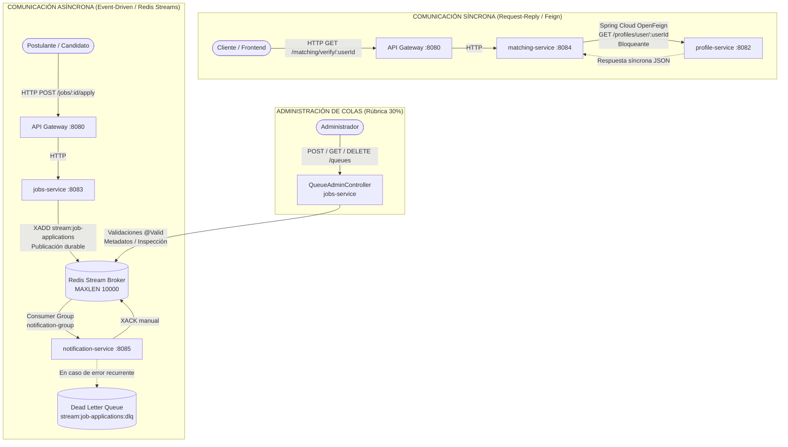

# Guía de Exposición y Evidencias — Mensajería Síncrona y Asíncrona
**Asignatura:** DSY1107 — Arquitectura y Microservicios  
**Proyecto:** Catch & Go  
**Integrantes:** Miguel Arredondo & Nicolás Iturrieta  
**Ubicación:** `Documentacion/Guia_Presentacion_Evaluacion_Mensajeria.md`

---

## 1. Resumen Ejecutivo de la Arquitectura Implementada

Se implementó el 100% de los requerimientos de evaluación y directrices docentes (PPTs de la asignatura), resolviendo la comunicación inter-microservicios tanto en modo **Síncrono (Request-Reply)** como **Asíncrono (Event-Driven Messaging)** sin depender de brokers pesados como RabbitMQ.



---

## 2. Reparto de la Presentación Oral (División de Roles)

### 👤 Nicolás Iturrieta — Comunicación Síncrona (25%)
**Objetivo:** Demostrar cómo se integran microservicios cuando se requiere consistencia inmediata y datos bloqueantes en tiempo real.

* **Guión de Exposición:**
  > *"Profesor, para el requisito de comunicación síncrona implementamos **Spring Cloud OpenFeign** en `matching-service`. En nuestra arquitectura de Catch & Go, cuando el motor de matching calcula sugerencias o verifica compatibilidad laboral, no puede continuar sin antes validar las habilidades y el perfil del candidato en tiempo real. Por ello, ejecuta una llamada HTTP bloqueante síncrona punto a punto hacia `profile-service` (`GET /profiles/user/{userId}`)."*
* **Aspectos Técnicos a destacar:**
  1. **Cliente declarativo:** En lugar de `RestTemplate` o llamadas imperativas, usamos una interfaz anotada con `@FeignClient` en `ProfileServiceClient.java`.
  2. **Logs diagnósticos y medición de latencia:** Registramos en milisegundos (`durationMs`) el tiempo exacto que tardó la llamada síncrona Request-Reply.
  3. **Tolerancia a fallos (Fallback Graceful):** Si `profile-service` presenta degradación o latencia excesiva, el servicio captura la excepción y retorna un fallback estructurado sin quebrar la experiencia del usuario.
* **Evidencia en vivo a mostrar:**
  * Archivos de código:
    * [`ProfileServiceClient.java`](file:///c:/Users/xkait/Desktop/Catch_Go/Catch-Go/Producto/backend/services/matching-service/src/main/java/com/catchandgo/matching/client/ProfileServiceClient.java)
    * [`MatchSuggestionService.java`](file:///c:/Users/xkait/Desktop/Catch_Go/Catch-Go/Producto/backend/services/matching-service/src/main/java/com/catchandgo/matching/service/MatchSuggestionService.java)
  * Petición en vivo:
    ```bash
    curl -X GET "https://api-gateway2-catch-go.up.railway.app/matching/verify/usr-test-123"
    ```

---

### 👤 Miguel Arredondo — Comunicación Asíncrona, Broker, ACK y DLQ (75%)
**Objetivo:** Demostrar desacoplamiento temporal, alta disponibilidad, confirmación explícita (ACK), cola de mensajes muertos (DLQ) y API de administración.

* **Guión de Exposición:**
  > *"Para la comunicación asíncrona, tal como se indicó en las presentaciones de la asignatura, priorizamos la infraestructura existente del proyecto sin recurrir a RabbitMQ (que requeriría un broker con motor Erlang de alto consumo). Utilizamos **Redis Streams 7**, disponible tanto en nuestro entorno local como en Railway Cloud.*
  > *Cuando un postulante aplica a un empleo (`POST /jobs/{id}/apply`), `jobs-service` publica el evento en `stream:job-applications` con retención `MAXLEN 10000` y responde de inmediato al usuario en milisegundos.*
  > *`notification-service` consume los mensajes usando Grupos de Consumidores (`notification-group`), asegurando entrega garantizada. Tras procesar la notificación y reenviarla vía WebSocket, emite un **ACK explícito (`XACK`)**. Si un mensaje falla repetidamente, se desvía a la **Dead Letter Queue (`stream:job-applications:dlq`)** para auditoría y no bloquear la cola principal.*
  > *Adicionalmente, cumpliendo con la rúbrica de administración de colas, creamos el módulo `QueueAdminController` con validaciones de entrada (`@Valid`), permitiendo crear, consultar, inspeccionar la DLQ y eliminar colas mediante REST."*
* **Aspectos Técnicos a destacar:**
  1. **Publicador durable:** `JobApplicationStreamPublisher.java` desacopla la postulación del envío de notificaciones.
  2. **Consumo con ACK manual:** `JobApplicationStreamConsumer.java` no auto-confirma; solo emite `XACK` cuando la lógica se completó exitosamente.
  3. **Dead Letter Queue (DLQ):** Captura payloads erróneos con metadatos de causa de fallo y fecha.
  4. **API de Administración:** Validaciones con `@NotBlank` que retornan `400 Bad Request` ante entradas inválidas.
* **Evidencias en vivo a mostrar:**
  * Endpoints REST:
    * `POST /jobs/1/apply` -> Desencadena evento asíncrono.
    * `GET /queues` -> Lista de colas activas y mensajes pendientes.
    * `GET /queues/job-applications/dlq` -> Mensajes en la DLQ.
    * `POST /queues` con JSON vacío -> Evidencia validación `400 Bad Request`.

---

## 3. Guía de Pruebas Rápidas para la Demostración

### A. Prueba de Comunicación Síncrona (OpenFeign)
**Endpoint Gateway:**
```bash
curl -i -X GET "https://api-gateway2-catch-go.up.railway.app/matching/verify/usr-nicolas-2026"
```
**Respuesta esperada:**
```json
{
  "durationMs": 12,
  "communicationType": "SYNCHRONOUS_HTTP_FEIGN",
  "userId": "usr-nicolas-2026",
  "status": "SUCCESS",
  "profile": {
    "userId": "usr-nicolas-2026"
  }
}
```

---

### B. Prueba de Administración de Colas (Rúbrica de Evaluación)

#### 1. Listar colas registradas:
```bash
curl -i -X GET "https://api-gateway2-catch-go.up.railway.app/queues"
```
**Respuesta esperada (HTTP 200 OK):**
```json
[
  {
    "name": "stream:job-applications",
    "type": "REDIS_STREAM",
    "length": 1,
    "consumerGroups": 1,
    "dlqAssociated": "stream:job-applications:dlq"
  }
]
```

#### 2. Crear una nueva cola:
```bash
curl -i -X POST "https://api-gateway2-catch-go.up.railway.app/queues" \
  -H "Content-Type: application/json" \
  -d '{"name":"stream:pagos-evaluacion","maxLen":5000}'
```
**Respuesta esperada (HTTP 201 Created):**
```json
{
  "name": "stream:pagos-evaluacion",
  "type": "REDIS_STREAM",
  "length": 0,
  "consumerGroups": 0,
  "dlqAssociated": "stream:pagos-evaluacion:dlq"
}
```

#### 3. Probar validación de entrada (Rúbrica: Retornar 400 Bad Request si los datos son inválidos):
```bash
curl -i -X POST "https://api-gateway2-catch-go.up.railway.app/queues" \
  -H "Content-Type: application/json" \
  -d '{"name":""}'
```
**Respuesta esperada (HTTP 400 Bad Request):**
```json
{
  "status": 400,
  "error": "Bad Request",
  "message": "Error de validacion en los datos de entrada",
  "fieldErrors": {
    "name": "El nombre de la cola es obligatorio"
  }
}
```

#### 4. Consultar mensajes en la Dead Letter Queue (DLQ):
```bash
curl -i -X GET "https://api-gateway2-catch-go.up.railway.app/queues/job-applications/dlq"
```

---

## 4. Preguntas Frecuentes del Docente (Defensa Técnica)

| Pregunta del Docente | Respuesta Sugerida |
| :--- | :--- |
| **¿Por qué usaron Redis Streams y no RabbitMQ si la rúbrica lo menciona?** | *"En las diapositivas de la asignatura (`act_.pptx` y `aCTIVIDAD 26-09-2026.pptx`), usted indicó explícitamente priorizar los servicios Cloud o existentes en el proyecto, dejando RabbitMQ solo como último recurso. Como Catch & Go ya contaba con Redis en Railway y Docker, adoptamos Redis Streams 7, el cual implementa de forma nativa grupos de consumidores, colas durables (`XADD`), confirmación `XACK` y `DLQ` sin requerir 200MB adicionales de memoria para el runtime de Erlang."* |
| **¿Qué diferencia técnica hay entre la llamada en `matching-service` y el evento en `jobs-service`?** | *"En `matching-service` la comunicación es **síncrona (Request-Reply)**: el hilo de ejecución se bloquea esperando la respuesta de `profile-service` antes de continuar. En cambio, en `jobs-service` la comunicación es **asíncrona (Event-Driven)**: el publicador envía el mensaje a la cola en memoria/disco de Redis y retorna inmediatamente HTTP 200 al cliente sin esperar que `notification-service` lo procese."* |
| **¿Cómo garantizan que un mensaje asíncrono no se pierda ante caídas del consumidor?** | *"Deshabilitamos el auto-acknowledgement. El contenedor `StreamMessageListenerContainer` procesa el mensaje y sólo emite `XACK` una vez que la notificación se envió con éxito. Si el pod o microservicio se cae a la mitad, el mensaje permanece en la Pending Entries List (PEL) de Redis y otro consumidor del grupo lo retoma."* |
| **¿Para qué sirve la Dead Letter Queue (DLQ)?** | *"Si un mensaje tiene datos corruptos o causa una excepción no recuperable, reintentarlo infinitamente bloquearía la cola (*poison pill*). Por ello, tras superar el límite de reintentos, el consumidor lo desvía a `stream:job-applications:dlq` con metadatos del error y emite el `XACK` en la cola principal para permitir el avance de los siguientes mensajes."* |
