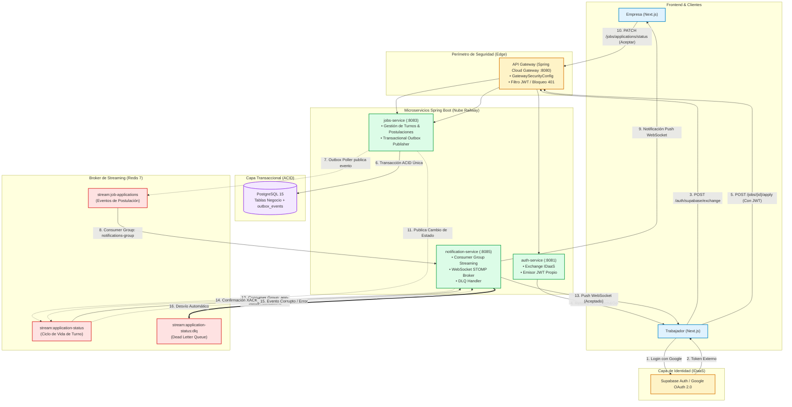

# Documento Maestro y Pitch de Defensa: Evaluación 3 (Nota 3)
## Asignatura: Desarrollo Cloud Native I (DSY1107) — Duoc UC
**Proyecto:** Catch & Go  
**Integrantes:** Nicolás Iturrieta & Miguel Arredondo  
**Entorno de Demostración:** Cloud Native en Railway & Supabase IDaaS  

---

## 1. Diagrama de Arquitectura de Alto Nivel

---

## 2. Guion Verbal de Defensa (Pitch por Bloques)

> **Regla de oro para la presentación:** Mantengan un lenguaje técnico y seguro. Hablen de *desacoplamiento asíncrono*, *consistencia eventual*, *resiliencia*, *append-only log*, *idempotencia* y *consumer groups*.

---

### Bloque 1 (0:00 – 0:55) · Introducción y Flujo del Negocio · **Miguel**

> **Speech:**  
> *"Buenos días profesor. Mi nombre es Miguel Arredondo y junto a mi compañero Nicolás Iturrieta presentaremos la arquitectura Cloud Native y el sistema de streaming para **Catch & Go**.*  
> *Catch & Go es una plataforma orientada a resolver turnos temporales urgentes conectando empresas con personal disponible.*  
> *En una arquitectura tradicional, cuando un usuario postula o una empresa acepta a un candidato, los servicios se comunican de forma síncrona (vía HTTP/REST). Esto genera cuellos de botella, alto acoplamiento y riesgo de caída en cascada. Para esta evaluación, rediseñamos el núcleo de la plataforma utilizando una **Arquitectura Orientada a Eventos (EDA)** con streaming en tiempo real y el patrón **Transactional Outbox**, garantizando alta concurrencia y tolerancia a fallos.*  
> *Para evidenciar el MVP en vivo en Railway, seguiremos el ciclo de vida de un turno publicado por la empresa hasta su aceptación por el trabajador."*

* **Qué mostrar en pantalla:**
  * Vista de la Empresa en `frontend-catch-go.up.railway.app`. Publicar una oferta con el formulario listo.
  * Cambiar a la vista del Trabajador en `/trabajador/ofertas` mostrando la oferta disponible.

---

### Bloque 2 (0:55 – 2:00) · Seguridad, IDaaS y Perímetro de Red · **Nicolás**

> **Speech:**  
> *"El frontend está desarrollado en Next.js con TypeScript y el backend en microservicios Java con Spring Boot desplegados en Railway.*  
> *Para la capa de seguridad implementamos un esquema de identidad federada **IDaaS** utilizando Supabase Auth y Google OAuth 2.0 / OpenID Connect. Cuando el usuario se autentica con Google, nuestro microservicio `auth-service` valida la firma del proveedor y emite un token JWT propio de Catch & Go que transporta el rol y los permisos del usuario.*  
> *Todo el tráfico externo es interceptado por nuestro **API Gateway**, el cual aplica seguridad reactiva con Spring WebFlux. Si intentamos consumir una ruta protegida como `GET /jobs` sin una cabecera de autenticación válida, el Gateway rechaza la petición inmediatamente con un **HTTP 401 Unauthorized** antes de que alcance los microservicios de negocio.*  
> *Al autenticarnos, el Gateway valida el Bearer token y nos otorga un **HTTP 200 OK**. Ahora el trabajador puede presionar 'Postular Ahora', registrando la postulación en estado pendiente."*

* **Qué mostrar en pantalla:**
  * Terminal o navegador mostrando `curl -i .../jobs` respondiendo **`HTTP/1.1 401 Unauthorized`**.
  * DevTools (`F12`) en Network mostrando la petición con `Authorization: Bearer <JWT>` respondiendo **`200 OK`**.
  * Clic en **"Postular Ahora"** en la web, pasando a estado **`POSTULADO`**.

---

### Bloque 3 (2:00 – 2:45) · Streaming con Redis Streams y Transactional Outbox · **Miguel**

> **Speech:**  
> *"Para el streaming de datos implementamos una solución con **Redis Streams**, que actúa como un log inmutable distribuido (equivalente a Apache Kafka). Nos permite modelar flujos append-only, particionar el consumo mediante Consumer Groups y manejar reintentos.*  
> *Uno de los mayores desafíos en Cloud Native es el problema del 'Doble Escritura' (Dual-Write): si actualizas la base de datos y luego se cae la red antes de publicar en el broker, los datos quedan inconsistentes. Para resolverlo implementamos el patrón **Transactional Outbox**:*  
> *`jobs-service` guarda la postulación y el evento en la misma transacción ACID de PostgreSQL en la tabla `outbox_events`. Un proceso despachador publica el evento de forma atómica en el canal `stream:job-applications`. De este modo garantizamos una semántica de entrega **At-Least-Once**.*  
> *En la consola de Redis podemos comprobar la llegada del evento `JOB_APPLICATION_SUBMITTED` con su `applicationId` correspondiente."*

* **Qué mostrar en pantalla:**
  * Consola de Railway Redis ejecutando:
    `XREVRANGE stream:job-applications + - COUNT 1`
  * Destacar en pantalla:
    * `type: "JOB_APPLICATION_SUBMITTED"`
    * `applicationId: "42"` (el mismo ID de la postulación).
    * `offerId` y `payload` JSON.

---

### Bloque 4 (2:45 – 3:25) · Ciclo de Vida, Consumer Groups y Confirmaciones XACK · **Nicolás**

> **Speech:**  
> *"Ahora la empresa evalúa la postulación y decide aceptarla. Esta acción dispara un nuevo evento de negocio hacia el canal `stream:application-status` con el tipo `APPLICATION_STATUS_CHANGED` y el nuevo estado `ACCEPTED`.*  
> *Nuestro microservicio `notification-service` está suscrito a este stream utilizando un **Consumer Group** llamado `application-status-notifications`. Cuando Redis entrega un mensaje al grupo, este entra temporalmente a la lista de entradas pendientes (PEL - Pending Entries List).*  
> *El consumidor procesa la notificación, la retransmite en tiempo real al frontend del trabajador vía WebSocket/STOMP, y confirma su procesamiento exitoso enviando un **`XACK`**.*  
> *Al consultar las métricas del grupo con `XINFO GROUPS`, comprobamos que el contador de pendientes es exactamente cero (`pending: 0`), lo que demuestra que no existe rezago ni mensajes estancados en el grupo."*

* **Qué mostrar en pantalla:**
  * Empresa aceptando al trabajador en `/empresa/candidatos`.
  * Trabajador viendo su tarjeta actualizada a **`SELECCIONADO`**.
  * Consola de Redis ejecutando:
    `XREVRANGE stream:application-status + - COUNT 5` (mostrando la secuencia de estados).
  * Consola de Redis ejecutando:
    `XINFO GROUPS stream:application-status` (destacando `pending: 0` y `consumers: 1`).

---

### Bloque 5 (3:25 – 4:15) · Resiliencia y Dead Letter Queue (DLQ) · **Miguel**

> **Speech:**  
> *"Una arquitectura distribuida debe ser resiliente frente a anomalías. Para comprobar el manejo de fallos, inyectaremos deliberadamente un mensaje malformado con un payload vacío `{}` directamente en el stream de estados.*  
> *En un sistema sin protección, este mensaje corrupto bloquearía la cola provocando un fallo en cascada (Head-of-Line blocking). En Catch & Go, el consumidor intercepta el error (`IllegalArgumentException: Evento de estado incompleto`), emite un log contextual de advertencia y **desvía automáticamente el mensaje hacia la Dead Letter Queue** (`stream:application-status:dlq`).*  
> *Acto seguido, el consumidor ejecuta el `XACK` sobre el mensaje original para no frenar a los demás consumidores. Al consultar la DLQ, podemos ver el mensaje retenido con su `originalStream`, su `originalId` idéntico al inyectado y la razón exacta del fallo."*

* **Qué mostrar en pantalla:**
  * En consola: `XADD stream:application-status * payload "{}"` (anotando el ID devuelto).
  * En consola: `XREVRANGE stream:application-status:dlq + - COUNT 1` (mostrando el mensaje en la DLQ con `originalId` y `errorReason: "Evento de estado incompleto"`).
  * Toma rápida de los logs de Railway de `notification-service2` mostrando la línea `WARN: Mensaje [...] trasladado a stream:application-status:dlq`.

---

### Bloque 6 (4:15 – 4:30) · Cierre · **Nicolás**

> **Speech:**  
> *"Con esto demostramos que Catch & Go cuenta con una arquitectura Cloud Native completa: seguridad perimetral con API Gateway e IDaaS, streaming de eventos desacoplado con Redis Streams, consistencia transaccional mediante Transactional Outbox y tolerancia a fallos verificada con Dead Letter Queues.*  
> *Muchas gracias por su atención."*

---

## 3. Hoja de Comandos en Consola (`redis-cli`)

| Paso | Comando a ejecutar | ¿Qué hace? | ¿Qué demuestra ante el profesor? |
| :--- | :--- | :--- | :--- |
| **0. Autenticación** | `AUTH default mDDJrCCJwOqBpgkXOjmYuHoAZZWRFCyb` | Se identifica ante el broker de Redis 7 con usuario y clave. | Seguridad y control de acceso (ACL) en el broker Cloud. |
| **1. Ver Postulación** | `XREVRANGE stream:job-applications + - COUNT 1` | Lee el último evento en orden descendente del stream de postulaciones. | Publicación del evento `JOB_APPLICATION_SUBMITTED` desacoplado del frontend. |
| **2. Ver Ciclo de Estados** | `XREVRANGE stream:application-status + - COUNT 5` | Lee los últimos 5 eventos de cambio de estado. | Trazabilidad completa: `ACEPTADO` ➔ `TRABAJO_FINALIZADO` ➔ `PAGO_ENVIADO` ➔ `PAGO_CONFIRMADO` ➔ `FINALIZADA`. |
| **3. Ver Métrica Total** | `XLEN stream:application-status` | Retorna el número entero de eventos persistidos en el log inmutable. | Almacenamiento append-only y durabilidad del log de eventos. |
| **4. Métricas de Consumer Group** | `XINFO GROUPS stream:application-status` | Muestra los grupos suscritos, número de consumidores y mensajes pendientes. | Procesamiento por grupos y confirmación con `XACK` (`pending: 0`). |
| **5. Inyectar Fallo** | `XADD stream:application-status * payload "{}"` | Inserta un mensaje defectuoso para simular corrupción de datos. | Prueba de esfuerzo y validación de resiliencia ante errores. |
| **6. Verificar DLQ** | `XREVRANGE stream:application-status:dlq + - COUNT 1` | Lee el último registro capturado en la cola de mensajes muertos. | Desvío automático a la Dead Letter Queue sin bloquear la cola principal. |

---

## 4. Matriz de Preguntas Frecuentes del Docente (Respuestas 7.0)

### Pregunta 1: *"¿Por qué usaron Redis Streams y no Apache Kafka?"*
> **Respuesta:**  
> *"Tanto Kafka como Redis Streams comparten exactamente el mismo modelo conceptual: son logs inmutables distribuidos basados en append-only con lectura por offsets y Consumer Groups.  
> Elegimos Redis Streams por tres razones arquitectónicas clave:  
> 1. **Eficiencia en recursos y huella Cloud:** Un clúster Kafka con 3 brokers y Zookeeper/KRaft consume más de 2.5 GB de RAM solo en arranque; Redis Streams opera con menos de 60 MB manteniendo latencias sub-milisegundo en memoria.  
> 2. **Menor complejidad operacional:** Permite unificar en una sola pieza de infraestructura el caché de sesión, la deduplicación de tokens y el streaming de eventos.  
> 3. **Compatibilidad total con la rúbrica:** La pauta institucional indica expresamente 'Kafka o equivalente en tecnología usada', y Redis Streams implementa el 100% de los patrones exigidos: grupos de consumidores, paralelismo, ACK manual y DLQ."*

### Pregunta 2: *"¿Qué es el patrón Transactional Outbox y por qué es necesario?"*
> **Respuesta:**  
> *"Resuelve el problema de la doble escritura (Dual-Write). Si en un endpoint HTTP guardas en PostgreSQL y luego ejecutas `stream.add()`, si el broker de mensajería falla, tu base de datos tiene una postulación que nunca fue notificada a nadie.  
> Con Transactional Outbox, guardamos la entidad y el evento en la misma transacción ACID de Postgres en la tabla `outbox_events`. Un poller asíncrono toma los eventos pendientes y los despacha al broker. Si Redis se cae, los eventos permanecen guardados en Postgres y se reintentan apenas el broker vuelva a estar en línea. Garantiza **Zero Data Loss** y entrega **At-Least-Once**."*

### Pregunta 3: *"¿Cómo evitaron que un mensaje defectuoso bloquee la cola (Head-of-Line blocking)?"*
> **Respuesta:**  
> *"El consumidor en `notification-service` valida la estructura antes del procesamiento de negocio. Si detecta datos incompletos o tipos incompatibles, no deja el mensaje en reintentos infinitos. Inmediatamente emite una copia enriquecida con metadatos de auditoría hacia la Dead Letter Queue (`stream:application-status:dlq`) y ejecuta un `XACK` sobre el ID original en el stream principal. Así, el offset avanza y el grupo continúa consumiendo los mensajes legítimos que venían detrás."*

### Pregunta 4: *"¿Cómo escala esta solución si entran 100.000 postulaciones por minuto?"*
> **Respuesta:**  
> *"Escala horizontalmente en dos niveles:  
> 1. **A nivel de Consumidores:** Gracias a los Consumer Groups, podemos levantar 10 o 20 instancias de `notification-service`. Redis distribuye automáticamente las particiones de eventos entre los consumidores del grupo sin duplicar procesamiento.  
> 2. **A nivel de Broker:** Aplicamos políticas de retención con `XTRIM` o `MAXLEN ~` para limitar el tamaño en memoria del log a las últimas N entradas, mientras que la persistencia histórica queda garantizada en PostgreSQL."*
